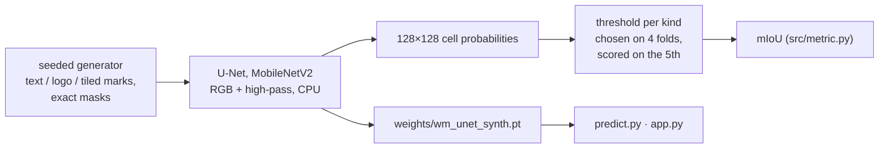
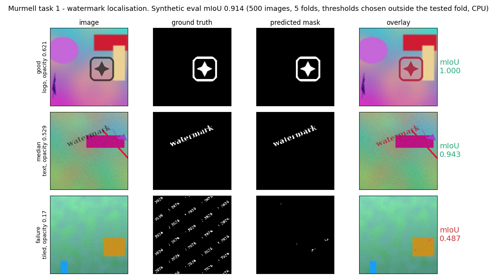

# Murmell

Pixel-level watermark localisation (which pixels of an image carry a watermark) with a U-Net you can retrain on a CPU, for
ML engineers who need masks rather than yes/no detectors; plus the team's 1st-of-44 European AI Championship code for model equality and unlearning.


```bash
git clone https://github.com/Wassbdr/murmell && cd murmell/task1_watermark_localisation
pip install -r requirements.txt        # CPU is enough; see requirements.txt for the CPU-only torch wheel
python app.py                          # http://127.0.0.1:7860  (or: python predict.py examples/good.png)
```

| Result (fresh, this repository) | Value | Setup |
|---|---|---|
| **Task 1 mIoU, nested 5-fold** (competition metric) | **0.914** (folds 0.921, 0.898, 0.925, 0.926, 0.898) | 500 synthetic eval images (seed 1), 5 folds, model trained on seed 1000 for 1800 × 16 images, 256 px, CPU only (8 threads), 31 min |
| Task 1 all-empty-mask baseline | 0.510 | same images and metric |
| Task 1 inference | 13 ms / image | 256 px, batch 32, CPU 8 threads |
| Task 2 score on a synthetic 33-endpoint bench | 0.894 (family MCC 1.00) | 5 seeds, toy LMs, numpy, CPU |
| Task 3 forecast error on a synthetic refit loop | MAE 0.0106 vs 0.0161 parent baseline | 5 seeds × 14 forecasts, numpy, CPU |
| Competition, final hidden split (historical) | **1st of 44**, overall 0.9819; task 1 0.8328 | [final_leaderboard.png](final_leaderboard.png); data not public, not rerun |



Every number above comes from code in this repository with fixed seeds; `bash showcase/make_showcase.sh` retrains,
re-evaluates and rebuilds the demo, the poster and [showcase/showcase.json](showcase/showcase.json).

## The three tasks

| Task | Run it now (synthetic, CPU) | Competition final (hidden 70 %) |
|---|---|---|
| [1. Watermark localisation](task1_watermark_localisation/) | `python -m src.train_synth`, `predict.py`, `app.py` | 0.8328, 2nd of 44 |
| [2. Model equality](task2_model_equality/) | `python -m simlab.run` | 1.0000, 1st (tied) |
| [3. Unlearning](task3_unlearning/) | `python -m simlab.refit` | 0.4749, 1st of 44 |

CI ([.github/workflows/tests.yml](.github/workflows/tests.yml)) runs the tests of the three tasks, `predict.py` on the
committed weights and both synthetic benches on every push.



## Competition write-up
Team Murmell, European AI Championship (CISPA hackathon), Paris, 21-22 November 2026.

**Slides:** [Murmell - Tasks 1 to 3 (6 min).pdf](slides/Murmell%20-%20Tasks%201%20to%203%20%286%20min%29.pdf)

Final ranking ([final_leaderboard.png](final_leaderboard.png)): Murmell is 1st of 44 teams overall, with 0.9819. The overall score is the mean of the three tasks after
rescaling each task so that the best team gets 1 and the last 0.

| Task | Public score | Final (hidden 70 %) | Best solution | Method, code, validation |
|---|---|---|---|---|
| 1. Watermark localisation | 0.8127 | 0.8328, 2nd of 44 | [B28_final.pt](https://github.com/Wassbdr/murmell/releases/tag/task1-best-model) (release) | [task1_watermark_localisation](task1_watermark_localisation/) |
| 2. Model equality | 1.00 | 1.0000, 1st, tied with 3 teams | [best_submission.csv](task2_model_equality/best_submission.csv) | [task2_model_equality](task2_model_equality/) |
| 3. Unlearning | 0.4806 | 0.4749, 1st of 44 | [cnsu_a32_repair100.pt](https://github.com/Wassbdr/murmell/releases/tag/task3-best-model) (release) | [task3_unlearning](task3_unlearning/) |

The final ranking gives one score per task and does not say which submission produced it: the best solution column is
our reference file, not necessarily the file behind the final score.

## One rule for all three tasks

The public leaderboard sees 30 % of the data; the final ranking uses the other 70 %. We made every decision on data
with known truth, never on the public score:

- Task 1: nested cross-validation on the 510 labelled training images.
- Task 2: the practice endpoints with published answers, and model families we simulated ourselves.
- Task 3: a forecast of every submission from earlier results only (mean error 0.004), and generated images held out
  from training.

## The idea of each task

- **Task 1.** Each test image comes with its watermark method and message, so the official decoder can tell where that
  message still is. We train U-Nets on images we watermark ourselves with the official embedder, starting from the
  decoder's own layers, and snap pasted objects to Segment Anything outlines.
- **Task 2.** We identified the three base models (Qwen2.5-3B, Qwen2.5-1.5B, Llama-3.2-1B), run them ourselves and score
  every answer. Disguises (system prompt, persona, watermark, temperature, top_k) and traps (fp8, LoRA doses) become
  statistical tests.
- **Task 3.** A model that never saw the forget images is wrong about 4 times out of 5, toward a sibling class. We teach
  the model those mistakes, estimated from its own answers on strongly altered views, then repair it on generated images
  so it stays identical to the original everywhere else.

## In this repository

Each task folder has a README with the method step by step, links to the code of each step, the validation and the
results. Compute: JURECA and our own GPUs. Datasets and leaderboard keys are not included; the submission scripts read
the key from environment variables.

## Roadmap and known limitations

- The fresh task 1 numbers are on synthetic **visible** watermarks. The competition images (PixelSeal, TrustMark,
  StegaStamp invisible watermarks) are not public and were not used; the committed model does not find invisible marks.
- Faint marks are the main failure: mIoU by opacity 0.15-0.30 0.85, 0.30-0.50 0.91, 0.50-0.70 0.93, 0.70-0.91 0.94; tiled marks
  (0.861) are harder than logos (0.948). The failure case of the demo is a tiled mark at opacity 0.17.
- Tasks 2 and 3 run on toy simulations of the competition problems (bigram LMs, a toy scorer). Their competition scores,
  and the task 3 competition forecast error (0.004), need the original endpoints and receipts and are not reproduced here.
- Next: train on public-domain photographs as backgrounds, add invisible-watermark embedders with redistributable code,
  and export the model to ONNX for a lighter install.
