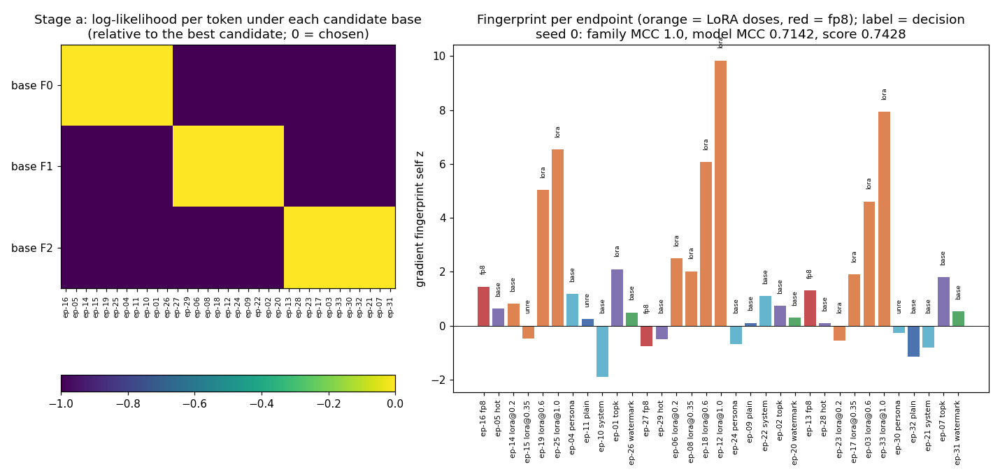

# Task 2: model equality

Run `make task2` after installation, or `python -m simlab.run` from `task2_model_equality/`.
The simulation groups 33 endpoints by shared base and exact model identity. It uses toy responses, not the
competition API. It writes per-seed CSVs to `out/simlab/` and the summary and chart to `results/`.
Use `--seeds`, `--out`, and `--results` to change the run.

The chart shows the family likelihood and fingerprint statistic for the first seed. See the
[task write-up](../task2_model_equality/README.md) for scoring and method details.
