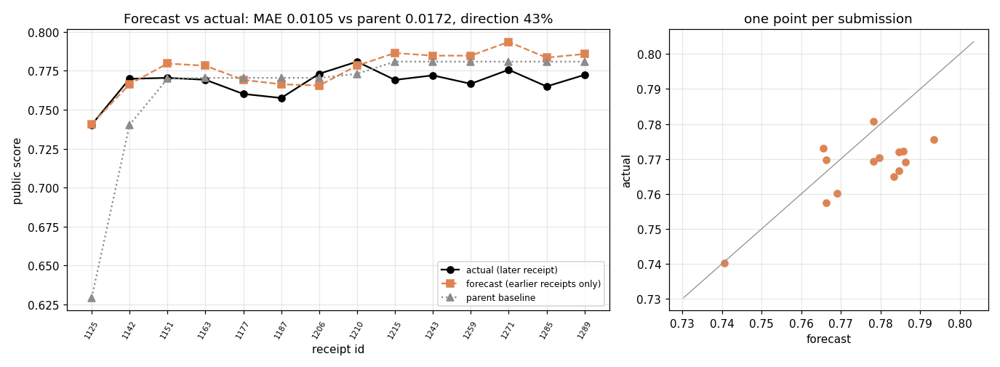

# Task 3: unlearning refit

Run `make task3` after installation, or `python -m simlab.refit` from `task3_unlearning/`.
It backtests a local score forecast against synthetic scoring receipts. It does not train or unlearn a real
classifier. Each seed writes its receipts under `out/simlab/`; the summary and chart go to `results/`.
Use `--seeds`, `--rounds`, `--out`, and `--results` to change the run.

See the [task write-up](../task3_unlearning/README.md) for the original constraints and synthetic scorer.
