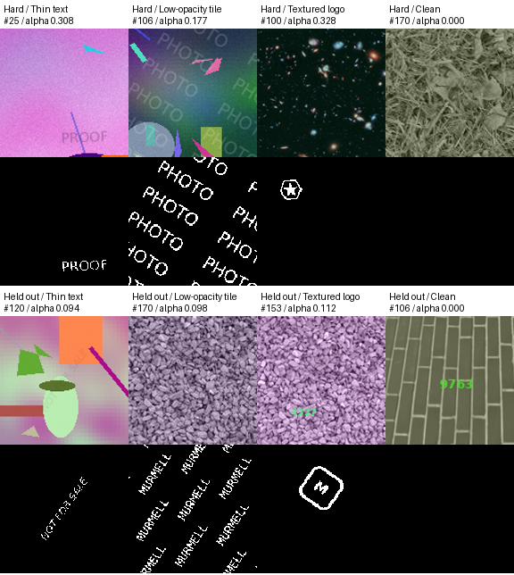

# Synthetic dataset audit

Regenerate with `make visible-audit`. Test seeds 12302 and 12303; 192 images per split.
Each image has its exact binary target below it. The grid selects the median opacity in each illustrated slice.

| Split | Slice | Marked scenes | Nonempty labels | Median mask area | P10 mask area | Median RGB signal | P10 RGB signal |
|---|---|---:|---:|---:|---:|---:|---:|
| Hard | All | 178 | 178 | 1.91% | 0.51% | 36.1 | 14.2 |
| Hard | Thin text | 63 | 63 | 0.77% | 0.39% | 28.5 | 10.6 |
| Hard | Low opacity | 40 | 40 | 1.88% | 0.51% | 22.0 | 11.8 |
| Hard | Textured | 96 | 96 | 2.22% | 0.58% | 35.4 | 10.4 |
| Held out | All | 171 | 171 | 1.89% | 0.46% | 9.4 | 4.7 |
| Held out | Thin text | 72 | 72 | 0.81% | 0.33% | 9.5 | 4.4 |
| Held out | Low opacity | 171 | 171 | 1.89% | 0.46% | 9.4 | 4.7 |
| Held out | Textured | 105 | 105 | 2.13% | 0.46% | 8.9 | 4.7 |

Signal is the maximum absolute per-channel RGB change (0 to 255) at labelled pixels, computed from the premultiplied watermark before JPEG. Area is relative to the full image.
