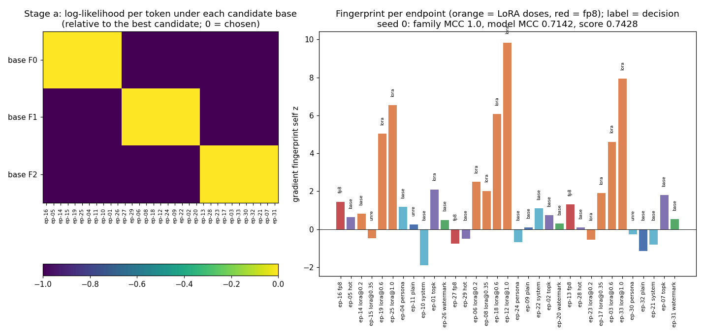

# Task 2: model equality

33 black-box LLM endpoints (`ep-01` to `ep-33`): text in, text out, at most 100 answers per endpoint, no logprobs,
sampling settings ignored. Decide which endpoints share a base model (family) and which serve exactly the same model.
Disguises keep the model identity (system prompt, persona, watermark, decoding). Traps change it (fp8 quantisation,
LoRA adapters at different strengths). Score: MCC over the 528 pairs, 10 % family and 90 % same model.

**Public score: 1.00** (first reached at 02:14 with [best_submission.csv](best_submission.csv)).
**Final score (hidden 70 %): 1.0000**, 1st, tied with three other teams.


## Run it from a clean clone (synthetic bench, CPU, about 1 minute)

The real endpoints and checkpoints are gone, so [simlab/](simlab/) rebuilds the problem with toy language models:
3 seeded bigram "base models", 11 endpoints each (6 disguises: plain, replaced system prompt, persona, temperature,
top_k, keyed watermark sampler; traps: an fp8-like copy and one low-rank adapter served at 4 doses), at most 100 answers
per endpoint. [simlab/stats.py](simlab/stats.py) computes each statistic of the pipeline with exact toy likelihoods; the
decisions and the score are the pipeline's own code (`pre_decide`, `decide`, `score_truth` in
[pipeline/me_pipeline.py](pipeline/me_pipeline.py)).

```bash
pip install -r requirements.txt
python -m simlab.run --seeds 0 1 2 3 4        # -> results/simlab.json, results/simlab_family_comparison.png
python -m pytest -q tests/test_simlab.py
```

| Synthetic bench (5 seeds, 33 endpoints each) | Value |
|---|---|
| Family MCC | **1.000** on every seed |
| Same-model MCC | 0.882 mean (1.000, 0.931, 0.931, 0.863, 0.714) |
| Task score (10 % family + 90 % model) | **0.894** mean |

Setup: seeds 0-4, numpy only, 8-core CPU, about 8 s per seed. Errors are mostly the weakest adapter dose (0.2) read as the
base and disguises left unresolved; they are listed per endpoint in `results/simlab.json`.



Left: stage a, the log-likelihood of each endpoint's answers under each candidate base (one bright cell per column = one
family). Right: the gradient-fingerprint self z that separates adapters (orange) from disguises; the label is the decision.

## Result

Three families of 11 endpoints. We identified the base checkpoints and run them locally:

| Family | Base model | Same model, disguised (one group) | fp8 copy | One LoRA, 4 doses (strongest first) |
|---|---|---|---|---|
| LL | Llama-3.2-1B-Instruct | 16 persona, 29 system prompt, 31 T 1.0, 10 watermark, 13 plain, 27 T 0.9 + top_k 50 | 15 | 05, 11, 09, 19 |
| QB | Qwen2.5-1.5B-Instruct | 20 persona, 08 system prompt, 30 T 1.0, 06 watermark, 32 plain, 07 T 0.9 + top_k 50 | 22 | 28, 03, 21, 26 |
| QA | Qwen2.5-3B-Instruct | 23 persona, 02 system prompt, 33 T 1.0, 04 watermark, plus the plain endpoint (open) | none | 24, 18, then weak doses (open) |

Every endpoint with its role and confidence: [endpoint_structure.csv](endpoint_structure.csv).

Two doubts remain, both in QA: which of ep-01, 12, 17, 25 is the plain base endpoint, and whether ep-14 is a weak LoRA
dose or the base model with top_k (our simulations say LoRA about 9 times out of 10). The organizers confirmed that the
best private score among all submissions counts, so every submission after 1.00 tests one of these hypotheses
([submissions.csv](submissions/submissions.csv)).

## Method

The idea: once the base checkpoints are known, every answer becomes a measurement. We score it under the base model and
run proper statistical tests instead of comparing texts by eye. Each test was validated on the practice endpoints
(`ref-01` to `ref-09`, answers published) and on families we built ourselves with known truth, before it touched a scored
endpoint. The public score was only used as a check.

| Step | Question | How | Code |
|---|---|---|---|
| 0. Collect | what to ask, within 100 answers | 16 short plain prompts (identity, extraction), 8 identical requests for repeatability, long 256-token answers | [tests/collect.py](tests/collect.py), [tests/plan_run.py](tests/plan_run.py), [pipeline/make_plan.py](pipeline/make_plan.py), [pipeline/prompts.json](pipeline/prompts.json) |
| 1. Family | which base checkpoint wrote this text | log-likelihood of the longest answers under each candidate checkpoint, default chat template, best temperature. Gap 0.09 to 0.2 nats per token, 11 of 11 endpoints per family | [pipeline/me_pipeline.py](pipeline/me_pipeline.py) `stage_family`, [tests/base_null.py](tests/base_null.py) |
| 2. Reset | strip prompt disguises | chat-template special tokens written inside the user message are interpreted by the server: a fake system turn neutralises most prompt disguises | [pipeline/prompts.json](pipeline/prompts.json) (reset block), [pipeline/README.md](pipeline/README.md) |
| 3. Prompt disguise | is the default system prompt still there | extraction prompts plus a likelihood ratio between the default system prompt and alternatives; plain answers scored at the endpoint's own temperature | [tests/ctx_llr.py](tests/ctx_llr.py), [tests/base_null.py](tests/base_null.py) |
| 4. Watermark | does an identical request repeat itself | longest common prefix between repeated answers, against simulated base answers. Watermarked endpoints repeat up to 108 characters, others at most 3. Known public watermark keys detect nothing ([tests/wm_known.py](tests/wm_known.py)) | `rep_pvalue` in [pipeline/me_pipeline.py](pipeline/me_pipeline.py), [tests/pfb_null.py](tests/pfb_null.py) |
| 5. Temperature | which sampling temperature | maximum-likelihood temperature of the long answers under the base (0.7 normal, 1.0 for the hot disguise) | [tests/calib.py](tests/calib.py) |
| 6. Truncation | top_k or top_p | tokens sampled beyond rank k or nucleus p, observed against expected. ep-27: 2 beyond rank 50 where 126 were expected | [tests/trunc_test.py](tests/trunc_test.py) |
| 7. fp8 | are these fp8 weights | likelihood ratio between our own exact fp8 copy (vLLM weight-only recipe) and the base, with its mean and variance under both hypotheses | [tests/quant_llr.py](tests/quant_llr.py) |
| 8. LoRA | does the endpoint deviate from the base weights, and in whose direction | gradient fingerprint: score test of each answer's log-likelihood on a random low-rank sketch of every linear weight. Self test, then pair test against the strongest adapter, p-values calibrated by sign flips over 24 prompt folds. Weak doses align with the strong one | [tests/gradfp.py](tests/gradfp.py), [tests/gfp_read.py](tests/gfp_read.py), [tests/gfp_dose.py](tests/gfp_dose.py), [tests/gradcal.py](tests/gradcal.py), [tests/proxy_lora_fast.py](tests/proxy_lora_fast.py) |
| 9. Decision | the partition | disguises first, then fp8, then fingerprint, then temperature with a clean fingerprint, rest is the base model | `decide` in [pipeline/me_pipeline.py](pipeline/me_pipeline.py), [tests/submit.py](tests/submit.py) |

[pipeline/](pipeline/) chains every step in one command, with no endpoint id in the code: answers in, `partition.csv`,
a diagnosis per endpoint and a confidence per pair out. Its run on all our answers produced
`m30_auto_pipeline` (public 1.00). Details and decision rules: [pipeline/README.md](pipeline/README.md).

## Validation

- **Practice endpoints**: every test is checked on `ref-01` to `ref-09` first. Fingerprint: LoRA doses 1.5, 0.7 and 0.3
  give z = +5.3, +5.2, +3.5; the base model sampled at T = 1 gives z = −0.4. fp8: only the fp8 practice endpoint is near 0.
  `python pipeline/me_pipeline.py --config pipeline/config_refs.json --answers ... --truth practice_answers.csv`.
- **Simulated families**: [simbench/](simbench/) builds families with known truth (SynthID-style watermark, LoRA doses,
  fp8 copies, top_k, temperature) from the prompts we really sent ([simbench/simgen.py](simbench/simgen.py)), then scores
  them with the same tests ([simbench/simgrad.py](simbench/simgrad.py), [simbench/simscore.py](simbench/simscore.py)).
  The dose rule (calibrated p ≤ 0.02 against the strongest dose, positive slope) gives MCC 1.000 on 5 simulated families.
- **The one failure we learned from**: at 01:42 we put seven endpoints per family in the base group because all had a
  normal temperature (public 0.60). One was a weak LoRA. The gradient fingerprint fixed it (1.00 at 02:14).

## Data

| File | Content |
|---|---|
| [data/answers_scored_endpoints.csv](data/answers_scored_endpoints.csv) | 2,041 prompts and answers of the 33 scored endpoints, with the role we identified |
| [data/answers_practice_endpoints.csv](data/answers_practice_endpoints.csv) | 868 answers of the practice endpoints |
| [submissions/submissions.csv](submissions/submissions.csv) | the 25 submissions: time, public score, groups, one column per endpoint |
| [submissions/files/](submissions/files/) | the CSV files exactly as submitted |

## Run

```
export HACKATHON_API_KEY=...            # never committed
python tests/collect.py answers.jsonl 16            # collection (resumable)
python pipeline/me_pipeline.py --config pipeline/config_scored.json --answers answers.jsonl --out out/
python tests/submit.py NAME 'ep-a+ep-b;ep-c+ep-d'   # groups, everything else is its own model
```

Needs a GPU (under 12 GB), `torch`, `transformers`, `peft`, `numpy`, and the three base checkpoints from Hugging Face.
